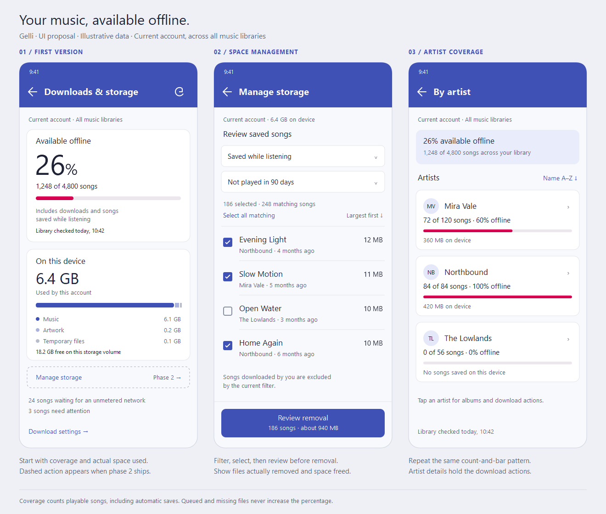

# Downloads & storage

The design for the screen that shows how much music is stored on the device and lets the user clean it up. The first part of the overview is built. The rest of this document is what remains.

## What exists

**Settings > Local Library > Downloads & storage** (`DownloadsActivity`, `DownloadsViewModel`, `DownloadsOverview`) shows:

- Coverage: the count, a percentage, and a progress bar of locally playable songs against a saved server inventory, plus the time of the last successful library check.
- Saved songs outside the inventory, as a separate count.
- A Saved audio card with the measured size of the account's audio files only.
- Loading, offline, unknown, empty, and error states, with manual refresh, refresh on reconnect, and updates from `LocalLibrary` listeners.

The scope is **Current account · All music libraries**, independent of the library selected for browsing. The inventory (`ServerSongInventory`, Room v11) finds libraries through Jellyfin user views, including music libraries hidden from the home screen. A failed or partial refresh keeps the previous snapshot. There are no cleanup controls yet.

## Remaining work

In order:

1. **Finish the overview.** Artwork and temporary-file usage, free space on the storage volume, and a status section for waiting, downloading, and failed saves. A navigation drawer entry reachable online and offline, and a **Download settings** link from the overview.
2. **Reliable deletion.** Today the removal path deletes rows even when a file deletion fails. Report failures, and keep tracking files that couldn't be removed, before building bulk cleanup on it.
3. **Manage storage.** Filters, sizes, last-played dates, sorting, selection, a removal review, and the actual results.
4. **Artist coverage.** Complete album-artist membership, cached totals, artist rows, and detail headers.

For each stage, check small, empty, and full libraries; partial inventory failures; files removed outside the app; account switches; and offline states with and without a snapshot. Check failed deletions and queued downloads during cleanup once storage management exists.

## Design reference

[Open the scalable mockup](downloads_storage_mockup.svg). All names, counts, and sizes are illustrative. The mockup predates the Material 3 color presets, so its indigo and pink are only placeholders.

## Overview

The first card answers "How much of my music can I play offline?"

- **26% available offline** as the headline, with a determinate horizontal bar.
- **1,248 of 4,800 songs** directly below. Use song coverage, rather than bytes transferred, for this bar.
- **Includes downloads and songs saved while listening** explains automatic saves.
- **Library checked today, 10:42** identifies how current the server inventory is. A toolbar refresh updates the inventory; local completions and removals update the numerator immediately.

The next card answers "How much space is it using?"

- **6.4 GB on this device**, scoped to this account's local library.
- **Music 6.1 GB · Artwork 0.2 GB · Temporary files 0.1 GB**. A small segmented bar shows the composition, with text labels so color is never required. Glide's browsing image cache isn't part of it.
- **18.2 GB free on this storage volume**, measured on the volume that holds these files. This is device free space, not a download quota.
- Add **Manage storage** here once that screen exists. Omit the button until then.

A compact status section below the cards keeps work in progress separate from coverage: **24 songs waiting for an unmetered network**, or **Downloading 1 of 24 songs**, with an optional **3 songs need attention** row. It only reports status; queue details, retry, and cancel can follow separately. Hide it when nothing is pending or failed. Do not offer "Download all" on the overview.

`SaveWorker` already has pending, downloading, and failed states, but `LocalLibrary` only notifies on completions, removals, and consistency changes. The status section needs notifications for enqueues and every state change too.

## What the percentage means

Let `C` be the distinct song IDs in a successfully refreshed server inventory for the account's accessible music libraries, and `L` be its locally playable song IDs. Coverage is `|C ∩ L| / |C| × 100`.

- A locally playable song has state `COMPLETE` and an existing, nonempty readable audio file. Queued, downloading, failed, missing, and partial files are excluded.
- Songs saved by playback and explicitly downloaded songs count equally. Original and transcoded versions count equally, once per song ID.
- Whole percentages, rounded down, so **100%** appears only when every inventoried song is available. Nonzero coverage below 1% shows **<1%**. The exact song counts stay visible.
- Local files absent from the inventory still occupy space. They show as **N additional saved songs outside the last library snapshot**, and are included in storage management. Never delete files just because an inventory changes.

| State | Overview behavior |
| --- | --- |
| First inventory loading | Keep the local saved count and storage visible; show "Checking music libraries…" and omit the percentage. |
| Offline, with snapshot | Coverage against the saved inventory, "Offline · Library checked [date/time]". |
| Offline or server error, no snapshot | "1,248 songs available offline" and "Connect to check total library size", with no percentage or bar. Offer refresh on an online error. |
| No locally saved songs, known nonempty library | "0% available offline" and "0 of 4,800 songs". Still to add: a hint pointing to Download in song and album menus. |
| Empty server inventory | "No songs in your music libraries", with no percentage or bar. |
| Download fails or waits for network | Coverage excludes these songs. They appear in the status section. |

## Manage storage

A separate **Manage storage** screen, opened from the storage card. Its scope matches the overview, including saved files outside the server inventory, and it must work offline.

Start with two filters: **All saved songs / Saved while listening / Downloaded by you**, and **Any time / Not played in 30, 90, or 180 days / Never played**. Default to all saved songs, and show a suggested **Review songs saved while listening, not played in 90 days** shortcut. Songs with no `lastPlayedAt` count as "Never played", and `addedAt` keeps newly saved songs out of the suggestion.

Show selectable songs with title, artist, file size, and last-played date. Sort by largest first by default, with oldest-played and name options. Selection starts empty. A fixed bottom action reads **Review removal · 186 songs · about 940 MB** only after a selection. Album and artist grouping and original/transcoded filters can follow without changing this flow.

Review before deleting. The dialog says **Remove 186 songs from this device?**, shows the estimated space freed, and explains: **The server library is unchanged. These songs will need streaming or downloading again.** If relevant, add **Songs saved while listening may be saved again when played.** Use **Cancel** and **Remove from device**, never "Clear cache". "Remove all saved songs" goes in the overflow menu, with the same review step.

After removal, show the actual number removed and the measured space recovered, update coverage and usage, and report any failures. A file that failed to delete stays tracked. Don't promise Undo. Removing completed songs leaves the save queue alone, since cancelling the queue is a separate action. Nothing is evicted automatically.

## Artist coverage

Add **By artist** below the overview. Each row shows the artist name, **72 of 120 songs · 60% offline**, a small coverage bar, and **360 MB on device**. Offer alphabetical, least available, and most storage sorting. Tapping a row opens artist details with the same coverage header, and download and removal actions stay on that screen.

Use album-artist membership, as the Album Artists browser does, for both the numerator and the denominator. `LocalSong` stores only one artist ID, so complete membership needs new data. Multi-artist songs may appear under several artists but count once in the account overview, so artist storage rows don't add up to the total. Fetch artist totals in batches or derive them from an inventory, never one request per visible row, and cache them for offline viewing with the same timestamp and unknown rules.

## Accessibility

Keep 48dp touch targets, support large text without clipping counts, expose a single coverage description ("1,248 of 4,800 songs, 26 percent available offline"), and don't announce every download completion. Unavailable and failed states always have text labels.
